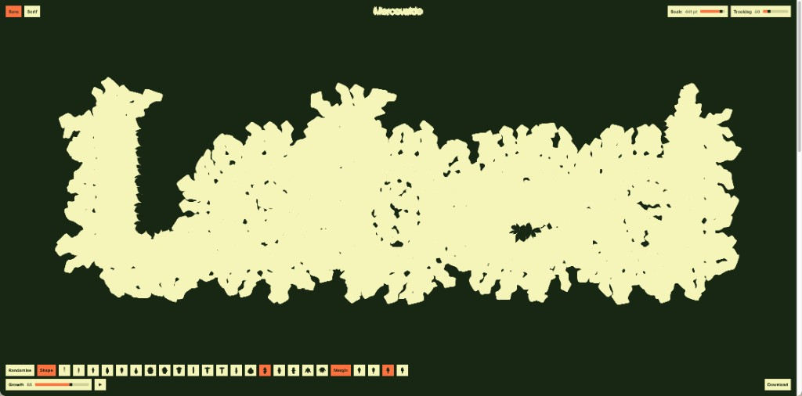
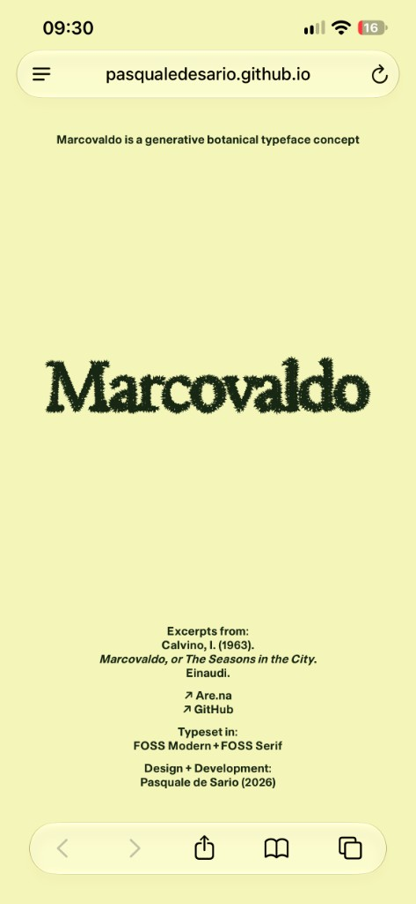

# Marcovaldo

Marcovaldo is a generative botanical typeface concept. Pick a leaf shape, from 19 morphologies ranging from lanceolate to palmate, and a margin, from 8 types ranging from entire to serrate; then tune the growth, and the letterforms morph without losing their structure.
The specimen text comes from Italo Calvino’s *Marcovaldo ovvero Le stagioni in città*, where nature finds its way through the cracks of the city.
Each configuration can be exported as an image (PNG, SVG, PDF), as a static (OTF) or variable font (TTF) with a GROW axis from 0 to 100 that follows the same growth curve as the tool.

<table>
  <tr>
    <td align="center" width="70%">
      
      <br /><sub>Desktop</sub>
    </td>
    <td align="center" width="30%">
      
      <br /><sub>Mobile</sub>
    </td>
  </tr>
</table>

On mobile the chrome is simplified and there is no editable specimen text.

## Run

```bash
npm ci
npm run dev      # http://127.0.0.1:5173/
npm run build
npm run preview
npm run ci       # typecheck + fontTools smokes + production build
```

Requires Node 22+ for CI; `smoke:vf` / parity need [fontTools](https://github.com/fonttools/fonttools) on `PATH` (`pip install fonttools`).

## Exports

| Format | What you get |
|--------|----------------|
| PNG / SVG / PDF | Stage snapshot at current growth |
| **OTF** | Static OpenType bake of the current morphology (growth curve applied) |
| **VF** | TrueType variable font with a `GROW` axis (0–100). Mid-axis uses `avar` so user GROW tracks the same nonlinear `growthCurve01` as the stage/OTF |

UI chrome is FOSS Modern; specimen face switches Sans / Serif. Typefaces: [FOSS Projects](https://www.foss-projects.com/typefaces) (subset Latin woff2 in `public/fonts/`).

## Limitations

- **Two-master VF:** only default and full-growth masters; intermediate shapes are linear (plus `avar`) between those outlines, not a full multi-master leaf continuum.
- **Export polish** uses a lighter Chaikin pass than on-canvas preview so point counts stay stable for `gvar`.
- **Charset** lists Latin + IT accents + typographic punctuation; FOSS Modern/Serif masters currently omit Latin diacritics, so accents are skipped at export until the faces include them.

## Stack

Vanilla TypeScript + Vite. No framework. Morphology core under `src/core/`; browser UI under `src/app/`; font writers under `src/export/`.

## License

[MIT](./LICENSE). Calvino excerpts and FOSS typefaces retain their respective rights.
